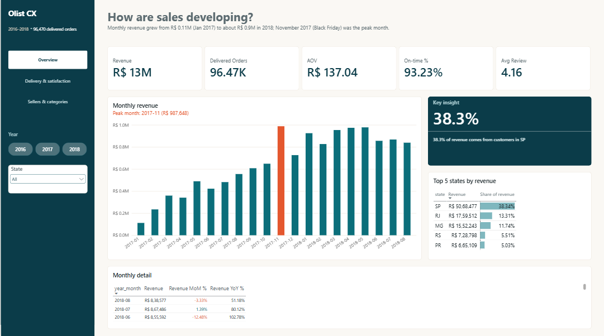
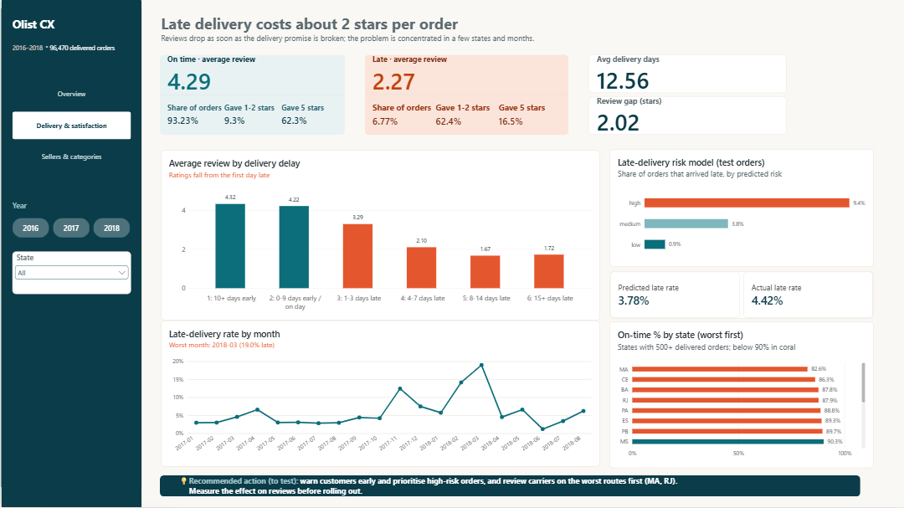
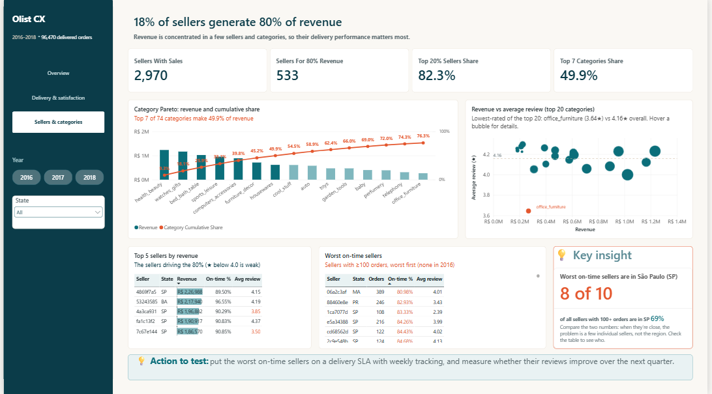
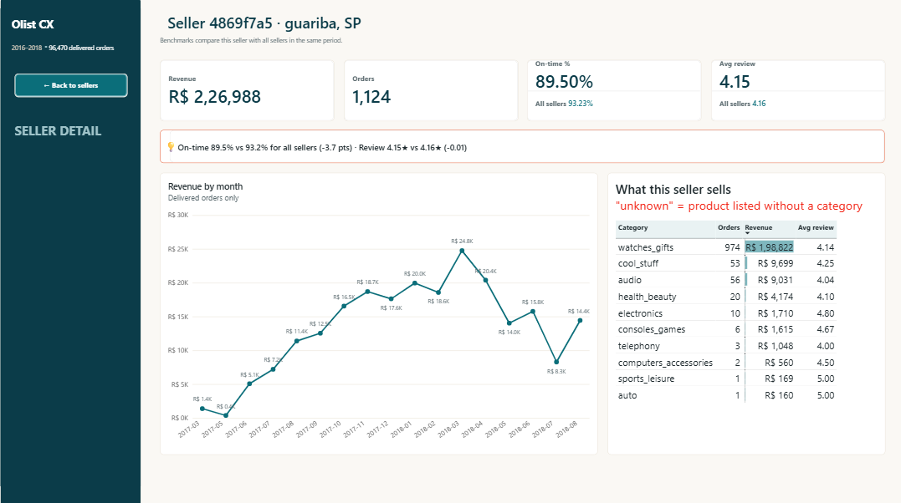

# E-commerce Customer Experience Analytics with ML & GenAI

> **Why do customers leave bad reviews, and can we predict and prevent late deliveries?**
> An end-to-end analysis of ~100,000 real e-commerce orders using **SQL, Python, Power BI, Excel, machine learning and GenAI**.

`SQL (DuckDB)` · `Python` · `pandas` · `scikit-learn` · `LightGBM` · `SHAP` · `Power BI` · `Excel` · `LLM text-to-SQL` · `LoRA / PEFT` · `Streamlit`

**Status:** 🚧 In progress. See [docs/PROGRESS.md](docs/PROGRESS.md)

---

## Key Results

*(Filled in from actual runs; every number is traceable to a notebook or script.)*

| Area | Result |
|---|---|
| Late deliveries vs reviews | Late orders average **2.27 ★** vs **4.29 ★** for on-time orders (Mann-Whitney p < 1e-300, effect size r = −0.64) |
| Worst delivery performance | On-time rate ranges from **82.64%** (Maranhão) to **95.96%** (Paraná); overall 93.23% |
| Late-delivery model | Test PR-AUC **0.094** [95% CI 0.087–0.104] vs 0.044 random; beats LightGBM (0.073) and the best simple rule (0.059); late-class F1 0.161 vs 0.130 / 0.124. The riskiest 1% of orders are late **14.0%** of the time (3.2× average) |
| "Ask the data" assistant | Execution accuracy **_% → _%** across improvement steps (40-question benchmark) |
| Review complaint themes | Macro-F1: TF-IDF _ · LoRA _ · zero-shot LLM _ |
| Recommendation | _ |

## How This Project Was Built, Step by Step

The project follows the standard analytics order: **understand the business → look at the data → check its quality → clean and model it → analyse → predict → report → add GenAI → share.** Each step builds on the one before it.

| # | Step | In plain words | Where to find it | Status |
|---|---|---|---|---|
| 1 | **Define the question** | Agree what we want to learn and how we'll judge success, before touching any data | [Requirements](docs/PROJECT_REQUIREMENTS.md), [Goals](docs/GOALS.md) | ✅ |
| 2 | **Get the data** | Download the 9 public data files from Kaggle with a script anyone can rerun | `scripts/download_data.py` | ✅ |
| 3 | **First look at the data** | Open every file and see its size, columns and example rows (pandas `read_csv`, `.info()`, `.head()`); confirm the database copy matches the files | [Audit notebook](notebooks/00_data_quality_audit.ipynb), section 0 | ✅ |
| 4 | **Clean and organise the data** | Using the problems spotted in the first look: fix types, remove duplicates, translate categories, then arrange the tables in a "star schema" that is fast and easy to analyse | `sql/01_staging.sql`, `sql/02_star_schema.sql` | ✅ |
| 5 | **Data-quality audit** | 45 written checks: measure every problem in the raw data (size, decision, reason) and confirm each fix worked in the cleaned tables | `sql/03_data_quality_checks.sql`, [Data-quality report](docs/DATA_QUALITY_REPORT.md) | ✅ |
| 6 | **Answer business questions with SQL** | 12 questions: monthly sales, best and worst states, sellers and categories, repeat customers, payment methods | `sql/04_business_queries.sql`, results in `sql/results/` | ✅ |
| 7 | **Explore and test the patterns** | Charts plus statistical tests: do late deliveries really cause worse reviews, and how big is the effect? | [EDA notebook](notebooks/01_eda.ipynb) | ✅ |
| 8 | **Predict late deliveries** | A model that estimates, at the moment of purchase, how likely an order is to arrive late, and explains why | [Model notebook](notebooks/02_late_delivery_model.ipynb) | ✅ |
| 9 | **Build the dashboard** | Power BI report for managers: overview, delivery and satisfaction, sellers and categories, plus a seller drill-through page; every number checked against SQL (48 checks) | `powerbi/` ([build guide](powerbi/POWERBI_GUIDE.md), [measures](powerbi/DAX_MEASURES_NOTES.md), [screenshots](#screenshots)) | ✅ |
| 10 | **Excel management report** | Monthly report with pivot tables and a what-if sheet | `excel/` | ⬜ |
| 11 | **GenAI: "Ask the data"** | Type a question in plain English, get a safe SQL answer; accuracy measured on 40+ test questions | `genai/text_to_sql/` | ⬜ |
| 12 | **Web app** | Interactive app with KPIs, late-delivery risk and the question box | `app/` | ⬜ |
| 13 | **GenAI: review themes** | Classify what unhappy customers complain about, comparing three approaches | `genai/review_themes/` | ⬜ |
| 14 | **Package and share** | Automated checks, final write-up, demo video | `.github/`, this README | ⬜ |

Every number in this README comes from code that was actually run; the full log with sources is in [docs/PROGRESS.md](docs/PROGRESS.md).

## What's Inside

| Component | Description |
|---|---|
| **Data-quality audit** | Every issue in the raw data (missing values, duplicate review IDs, impossible date sequences, multi-seller orders, Portuguese categories, duplicate geolocation) sized, fixed and justified. See [docs/DATA_QUALITY_REPORT.md](docs/DATA_QUALITY_REPORT.md) |
| **SQL data model** | DuckDB star schema (orders, items, customers, sellers, products, dates) + 12 business analyses: cohorts, Pareto, window functions |
| **EDA** | Data quality, delivery delays, late vs on-time reviews (statistical test), state and seasonality patterns |
| **Late-delivery model** | Purchase-time features only (no leakage), time-based split, logistic regression vs LightGBM (logistic regression won), cost-based threshold, SHAP |
| **Power BI dashboard** | Executive overview · Delivery & satisfaction · Sellers & categories · Seller detail (drill-through); 51 documented DAX measures; titles and insights update with the year and state slicers |
| **Excel report** | Monthly management report with PivotTables, slicers and a what-if sheet |
| **GenAI 1: Ask the data** | Natural-language questions → safe, read-only SQL; improved step by step (descriptions, semantic layer, few-shot retrieval, self-correction) and measured on a benchmark |
| **GenAI 2: Review themes** | Complaint-theme classification of Portuguese reviews: TF-IDF vs LoRA-tuned transformer vs zero-shot LLM |
| **Streamlit app** | KPIs, late-delivery risk, Ask the data, review themes |

## Architecture

See [docs/ARCHITECTURE.md](docs/ARCHITECTURE.md).

```text
Olist CSVs → DuckDB (staging → star schema → SQL analyses)
   → EDA · late-delivery model (logistic regression vs LightGBM) · Power BI · Excel
   → GenAI: text-to-SQL assistant (evaluated) · review-theme classifier (LoRA vs baselines)
   → Streamlit app (deployed)
```

## Screenshots

### Power BI dashboard

**1. Executive overview:** how sales are developing (monthly revenue, peak month, top states).


**2. Delivery & satisfaction:** late delivery costs about 2 stars per order; late-rate spikes by month; the risk model's bands on test orders.


**3. Sellers & categories:** 18% of sellers generate 80% of revenue; category Pareto; revenue vs review; best and worst sellers.


**4. Seller detail (drill-through):** right-click any seller to see their revenue, on-time rate and reviews against all sellers.


*(App pages and the accuracy-per-step chart will be added later.)*

## Run It Locally

```bash
# 1. Python 3.12 virtual environment
py -3.12 -m venv .venv
.venv\Scripts\activate            # Windows  (Linux/macOS: source .venv/bin/activate)
pip install -r requirements.txt

# 2. Data: download the Olist dataset from Kaggle into data/raw/
python scripts/download_data.py   # or download manually (see below)

# 3. Build the DuckDB database (raw tables, staging, star schema)
python scripts/build_db.py

# 4. Run the 12 business queries (results saved to sql/results/)
python scripts/run_queries.py

# 5. Open the notebooks in order: 00 (first look + audit) -> 01 (EDA) -> 02 (model)
jupyter lab notebooks/

# 6. Tests and lint
pytest
ruff check .

# Coming later: configure the LLM key (copy .env.example to .env) and run the app
# streamlit run app/streamlit_app.py
```

## Project Structure

```text
docs/  sql/  scripts/  notebooks/  src/  models/  genai/  app/  powerbi/  excel/  tests/
```

## Documentation

- [Project Requirements](docs/PROJECT_REQUIREMENTS.md)
- [Goals](docs/GOALS.md)
- [Architecture](docs/ARCHITECTURE.md)
- [Progress](docs/PROGRESS.md)

## Dataset and Credits

[Brazilian E-Commerce Public Dataset by Olist](https://www.kaggle.com/datasets/olistbr/brazilian-ecommerce) (Kaggle). Real, anonymised commercial data from 2016–2018. Used for non-commercial portfolio purposes; see the dataset page for licence terms.

## Author

**Masood Manzoor Ahmed**: MSc Data Science (University of Greenwich)
[LinkedIn](https://www.linkedin.com/in/masoodmanzoorahmed) · [GitHub](https://github.com/MasoodManzoorAhmed)
