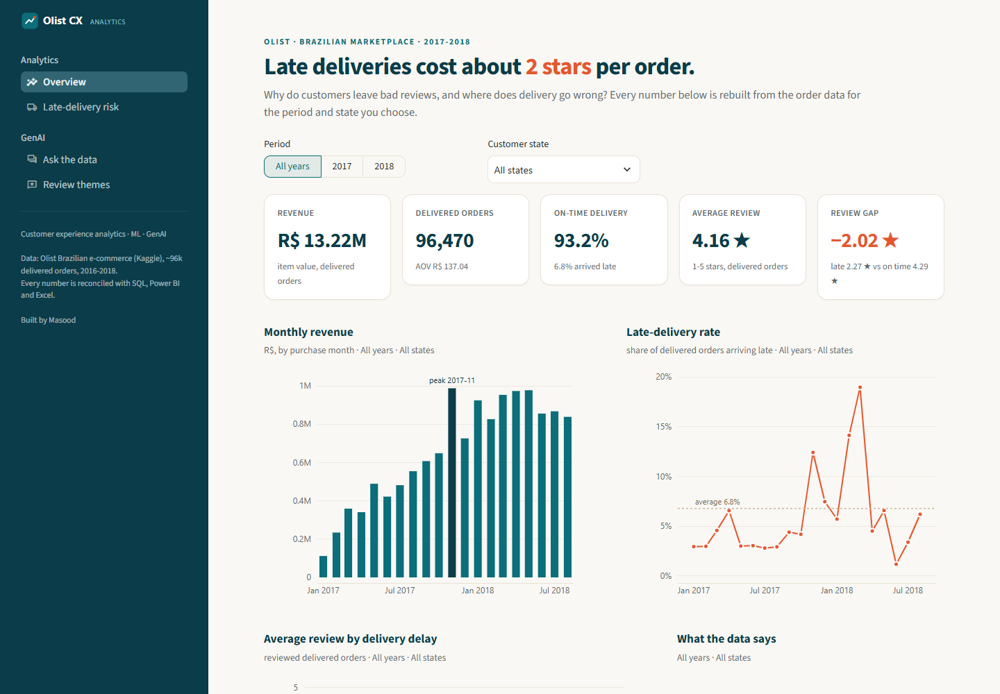
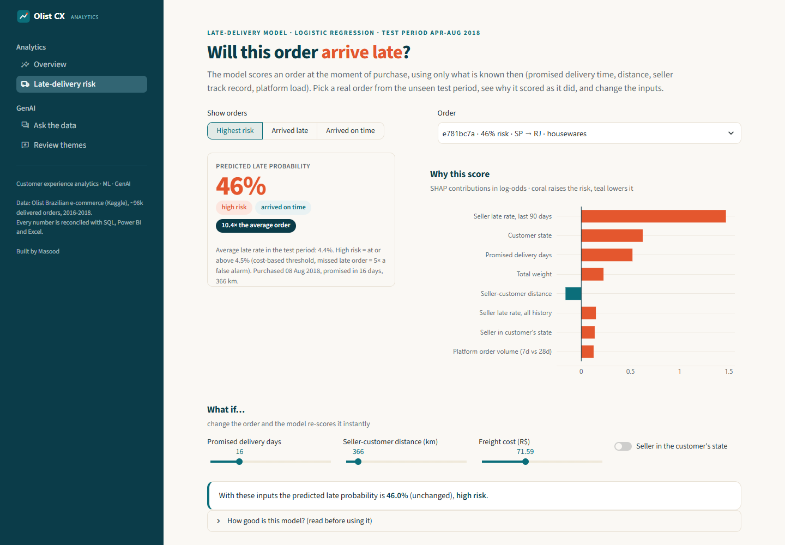
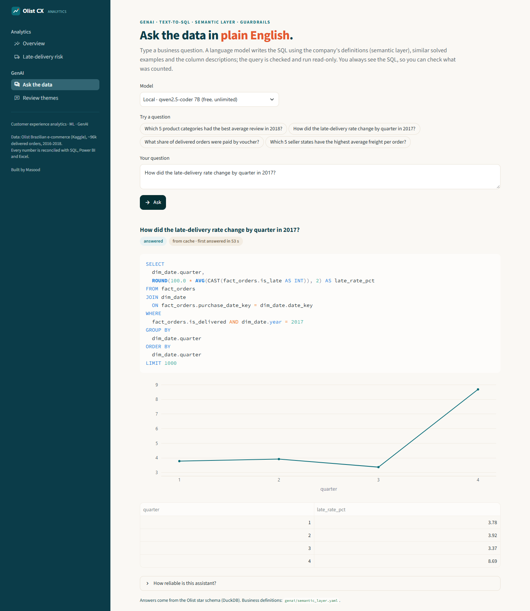
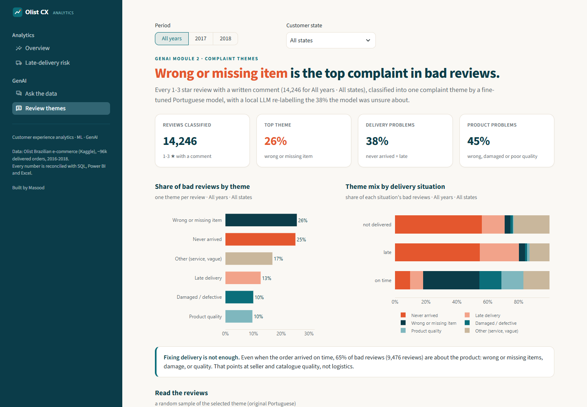
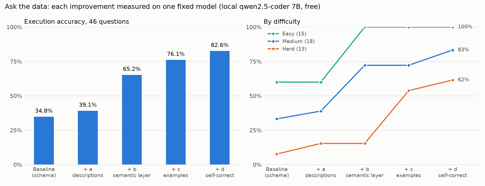

# E-commerce Customer Experience Analytics with ML & GenAI

[](https://github.com/MasoodManzoorAhmed/ecommerce-customer-experience-analytics-with-GenAI/actions/workflows/ci.yml) [](LICENSE)

**Live app:** [olist-cx-analytics.streamlit.app](https://olist-cx-analytics.streamlit.app/) (Overview, Late-delivery risk and Review themes run in the browser; "Ask the data" needs the local database and runs on a laptop. A free app may take ~30 s to wake up.)

> **Why do customers leave bad reviews, and can we predict and prevent late deliveries?**
> An end-to-end analysis of ~100,000 real e-commerce orders using **SQL, Python, Power BI, Excel, machine learning and GenAI**.

`SQL (DuckDB)` · `Python` · `pandas` · `scikit-learn` · `LightGBM` · `SHAP` · `Power BI` · `Excel` · `LLM text-to-SQL` · `LoRA / PEFT` · `Hugging Face Transformers` · `Ollama` · `Streamlit`

**Status:** 🚧 In progress. See [docs/PROGRESS.md](docs/PROGRESS.md)

---

## Key Results

*(Filled in from actual runs; every number is traceable to a notebook or script.)*

| Area | Result |
|---|---|
| Late deliveries vs reviews | Late orders average **2.27 ★** vs **4.29 ★** for on-time orders (Mann-Whitney p < 1e-300, effect size r = −0.64) |
| Worst delivery performance | On-time rate ranges from **82.64%** (Maranhão) to **95.96%** (Paraná); overall 93.23% |
| Late-delivery model | Test PR-AUC **0.094** [95% CI 0.087–0.104] vs 0.044 random; beats LightGBM (0.073) and the best simple rule (0.059); late-class F1 0.161 vs 0.130 / 0.124. The riskiest 1% of orders are late **14.0%** of the time (3.2× average) |
| "Ask the data" assistant | Execution accuracy **34.8% → 80.4%** on a 46-question benchmark, adding one improvement at a time (column descriptions, semantic layer, retrieved examples, self-correction) on a free local model; the semantic layer gave the largest gain (+11 questions). The same pipeline on a hosted free model (north-mini-code): **93.5%**. US$0 |
| Review complaint themes | 14,246 bad reviews (1-3 ★, Portuguese) classified into 6 themes. On 200 hand-labelled reviews: zero-shot LLM macro-F1 **0.781**, LoRA-tuned BERTimbau 0.714, TF-IDF 0.697. A cascade (LoRA first, LLM only when LoRA is under 70% sure) matched the LLM while sending it 38% of reviews. Gold labels checked by an independent model: Cohen's kappa **0.876**. Top themes: wrong or missing item **25.6%**, never arrived **25.1%** |
| Recommendation | Two levers, not one. (1) **Delivery:** late orders lose about 2 stars; target the worst states and audit "delivered" confirmations (936 bad reviews on orders marked delivered on time say the item never came). (2) **Sellers and catalogue:** even on on-time orders, **65%** of bad reviews are about the product (wrong or missing items, damage, quality), so seller quality checks matter as much as logistics |

## How This Project Was Built, Step by Step

The project follows the standard analytics order: **understand the business → look at the data → check its quality → clean and model it → analyse → predict → report → add GenAI → share.** Each step builds on the one before it.

| # | Step | In plain words | Where to find it | Status |
|---|---|---|---|---|
| 1 | **Define the question** | Agree what we want to learn and how we'll judge success, before touching any data | [Requirements](docs/PROJECT_REQUIREMENTS.md) | ✅ |
| 2 | **Get the data** | Download the 9 public data files from Kaggle with a script anyone can rerun | `scripts/download_data.py` | ✅ |
| 3 | **First look at the data** | Open every file and see its size, columns and example rows (pandas `read_csv`, `.info()`, `.head()`); confirm the database copy matches the files | [Audit notebook](notebooks/00_data_quality_audit.ipynb), section 0 | ✅ |
| 4 | **Clean and organise the data** | Using the problems spotted in the first look: fix types, remove duplicates, translate categories, then arrange the tables in a "star schema" that is fast and easy to analyse | `sql/01_staging.sql`, `sql/02_star_schema.sql` | ✅ |
| 5 | **Data-quality audit** | 45 written checks: measure every problem in the raw data (size, decision, reason) and confirm each fix worked in the cleaned tables | `sql/03_data_quality_checks.sql`, [Data-quality report](docs/DATA_QUALITY_REPORT.md) | ✅ |
| 6 | **Answer business questions with SQL** | 12 questions: monthly sales, best and worst states, sellers and categories, repeat customers, payment methods | `sql/04_business_queries.sql`, results in `sql/results/` | ✅ |
| 7 | **Explore and test the patterns** | Charts plus statistical tests: do late deliveries really cause worse reviews, and how big is the effect? | [EDA notebook](notebooks/01_eda.ipynb) | ✅ |
| 8 | **Predict late deliveries** | A model that estimates, at the moment of purchase, how likely an order is to arrive late, and explains why | [Model notebook](notebooks/02_late_delivery_model.ipynb) | ✅ |
| 9 | **Build the dashboard** | Power BI report for managers: overview, delivery and satisfaction, sellers and categories, plus a seller drill-through page; every number checked against SQL (48 checks) | `powerbi/` ([build guide](powerbi/POWERBI_GUIDE.md), [measures](powerbi/DAX_MEASURES_NOTES.md), [screenshots](#screenshots)) | ✅ |
| 10 | **Excel management report** | Monthly KPI pack (month and state selectors), PivotTables with slicers and PivotCharts, a what-if sheet with Data Tables, and 19 reconciliation checks against SQL | `excel/Monthly_CX_Report.xlsx`, `scripts/build_excel_report.py` | ✅ |
| 11 | **GenAI: "Ask the data"** | Type a question in plain English, get a safe SQL answer; accuracy measured on 46 test questions, 34.8% → 80.4% step by step ([chart](#ask-the-data-accuracy-per-improvement-step)), 93.5% on a hosted free model | `genai/semantic_layer.yaml`, `genai/eval/`, `genai/text_to_sql/` | ✅ (Gemma comparison pending) |
| 12 | **Web app** | Streamlit app: Overview (KPIs and the delay → review story, filterable), Late-delivery risk (score a real order, SHAP explanation, what-if sliders), Ask the data (SQL always shown) | `app/` | ✅ local (deployment on Day 7) |
| 13 | **GenAI: review themes** | Classify what unhappy customers complain about: three approaches compared on 200 hand-labelled reviews, then a LoRA + LLM cascade labels all 14,246 ([results](#review-themes-three-approaches-compared)) | `genai/review_themes/` | ✅ |
| 14 | **Package and share** | Automated checks, final write-up, demo video | `.github/`, this README | ⬜ |

Every number in this README comes from code that was actually run; the full log with sources is in [docs/PROGRESS.md](docs/PROGRESS.md).

## What's Inside

| Component | Description |
|---|---|
| **Data-quality audit** | Every issue in the raw data (missing values, duplicate review IDs, impossible date sequences, multi-seller orders, Portuguese categories, duplicate geolocation) sized, fixed and justified. See [docs/DATA_QUALITY_REPORT.md](docs/DATA_QUALITY_REPORT.md) |
| **SQL data model** | DuckDB star schema (orders, items, customers, sellers, products, dates) + 12 business analyses: cohorts, Pareto, window functions |
| **EDA** | Data quality, delivery delays, late vs on-time reviews (statistical test), state and seasonality patterns |
| **Late-delivery model** | Purchase-time features only (no leakage), time-based split, logistic regression vs LightGBM (logistic regression won), cost-based threshold, SHAP |
| **Power BI dashboard** | Executive overview · Delivery & satisfaction · Sellers & categories · Seller detail (drill-through); 51 documented DAX measures; titles and insights update with the year and state slicers |
| **Excel report** | Monthly management report: KPIs vs previous month and last year, PivotTables with slicers, a what-if on the review value of on-time delivery, and a checks sheet (19/19 pass); rebuilt from the database by one script |
| **GenAI 1: Ask the data** | Natural-language questions → safe, read-only SQL; improved step by step (descriptions, semantic layer, few-shot retrieval, self-correction) and measured on a benchmark |
| **GenAI 2: Review themes** | Complaint-theme classification of Portuguese reviews: TF-IDF vs LoRA-tuned BERTimbau vs zero-shot LLM, then a confidence cascade over all reviews → `fact_review_theme` |
| **Streamlit app** | Overview (filterable KPIs and the delay → review story), late-delivery risk with SHAP and what-if sliders, Ask the data (local or hosted free model, SQL always shown), review themes (Module 2) · same design system as Power BI and Excel |

## Architecture

See [docs/ARCHITECTURE.md](docs/ARCHITECTURE.md).

```text
Olist CSVs → DuckDB (staging → star schema → SQL analyses)
   → EDA · late-delivery model (logistic regression vs LightGBM) · Power BI · Excel
   → GenAI: text-to-SQL assistant (evaluated) · review-theme classifier (LoRA vs baselines)
   → Streamlit app (deployed)
```

## Screenshots

### Power BI dashboard

**1. Executive overview:** how sales are developing (monthly revenue, peak month, top states).


**2. Delivery & satisfaction:** late delivery costs about 2 stars per order; late-rate spikes by month; the risk model's bands on test orders.


**3. Sellers & categories:** 18% of sellers generate 80% of revenue; category Pareto; revenue vs review; best and worst sellers.


**4. Seller detail (drill-through):** right-click any seller to see their revenue, on-time rate and reviews against all sellers.


### Streamlit app ([live](https://olist-cx-analytics.streamlit.app/))

**1. Overview:** every KPI rebuilt for the chosen year and state; late deliveries cost about 2 stars.


**2. Late-delivery risk:** a real order from the unseen test period, its predicted risk, the SHAP reasons and what-if sliders.


**3. Ask the data:** a plain-English question becomes SQL (always shown), checked by guardrails and run read-only; the answer as a chart and table (runs locally with the free Ollama model).


**4. Review themes:** 14,246 bad reviews classified; even on-time orders get bad reviews mainly for product problems.


### "Ask the data": accuracy per improvement step



One fixed model (local `qwen2.5-coder:7b` via Ollama, free and offline), the same 46 questions each time, one
improvement added per step. A query counts as correct when its **result** matches the hand-checked answer
(execution accuracy).

| Step | Added to the prompt | Accuracy | Easy (15) | Medium (18) | Hard (13) |
|---|---|---|---|---|---|
| Baseline | Table and column names | 34.8% | 60.0% | 33.3% | 7.7% |
| + a | Column descriptions and stored values | 39.1% | 60.0% | 38.9% | 15.4% |
| + b | Semantic layer (business definitions) | 63.0% | 93.3% | 72.2% | 15.4% |
| + c | 3 retrieved similar examples | 76.1% | 100% | 72.2% | 53.8% |
| + d | Self-correction (error sent back once) | **80.4%** | 100% | 77.8% | 61.5% |

Source: `genai/results/text_to_sql_summary.csv` (`python -m genai.text_to_sql.report`). The best configuration
(a+b+c+d) on a hosted free model, `cohere/north-mini-code:free`: **43/46 = 93.5%** (easy 100%, medium 94.4%,
hard 84.6%). A third model (Gemma-4-31B) runs within the free daily quota and will be added here.

### Review themes: three approaches compared

Every 1-3 star review with a comment (14,246, in Portuguese) gets one complaint theme: never arrived, wrong or
missing item, damaged, late delivery, product quality, other. All approaches were scored on the same 200
hand-labelled reviews, which none of them saw during training.

| Approach | How it works | Macro-F1 | Accuracy | Seconds per review |
|---|---|---|---|---|
| Zero-shot LLM | Local `qwen2.5-coder:7b`, theme definitions in the prompt, 20 reviews per request | **0.781** | 79.0% | 3.9 |
| LoRA fine-tune | BERTimbau (Portuguese BERT), 0.27% of weights trained on 1,500 LLM-labelled reviews, 21 min on a laptop CPU | 0.714 | 73.5% | 0.11 |
| TF-IDF + logistic regression | Word and character patterns, trained on the same 1,500 labels | 0.697 | 71.0% | 0.0006 |

The LLM is the most accurate but the slowest. **Cascade used for the final labels:** LoRA labels every review,
and the 38% it is less than 70% sure about go to the LLM. On the 200 test reviews this matched the LLM's
quality (0.789; the threshold was chosen on this set, so read it as "LLM-level", not "better"). Final themes:
wrong or missing item 25.6% · never arrived 25.1% · other 16.9% · late delivery 12.7% · damaged 10.0% ·
product quality 9.7%. **Label check:** a second model from another provider (north-mini-code) labelled the 200 gold
reviews blind: 90% agreement, Cohen's kappa 0.876. Source: `genai/review_themes/results/approach_comparison.csv`,
`second_annotator_agreement.json`, `docs/PROGRESS.md`.

## Run It Locally

```bash
# 1. Python 3.12 virtual environment
py -3.12 -m venv .venv
.venv\Scripts\activate            # Windows  (Linux/macOS: source .venv/bin/activate)
pip install -r requirements.txt

# 2. Data: download the Olist dataset from Kaggle into data/raw/
python scripts/download_data.py   # or download manually (see below)

# 3. Build the DuckDB database (raw tables, staging, star schema)
python scripts/build_db.py

# 4. Run the 12 business queries (results saved to sql/results/)
python scripts/run_queries.py

# 5. Open the notebooks in order: 00 (first look + audit) -> 01 (EDA) -> 02 (model)
jupyter lab notebooks/

# 6. Power BI data and reconciliation values (then open powerbi/olist_cx_dashboard.pbix)
python scripts/export_powerbi.py
python scripts/powerbi_expected_values.py

# 7. Excel monthly report (Windows + Excel; rebuilds excel/Monthly_CX_Report.xlsx)
python scripts/build_excel_report.py

# 8. "Ask the data" evaluation (free). Local model: install Ollama (ollama.com), then
ollama pull qwen2.5-coder:7b
ollama create qwen2.5-coder-16k -f genai/ollama/Modelfile
python -m genai.text_to_sql.eval_set                      # expected answers from the gold SQL
python -m genai.text_to_sql.evaluate --config a+b+c+d --model ollama/qwen2.5-coder-16k
python -m genai.text_to_sql.report                        # chart + summary table
#    Hosted free models: copy .env.example to .env, add an OpenRouter key, omit --model

# 9. Review themes (Module 2): split, LLM labels, the three approaches, then all reviews
python -m genai.review_themes.data                   # gold 200 / train 1,500 split
python -m genai.review_themes.llm_labeler gold       # zero-shot LLM on the gold set
python -m genai.review_themes.llm_labeler train      # training labels (the "teacher")
python -m genai.review_themes.tfidf
pip install -r requirements-finetune.txt            # transformers + peft for the LoRA step
python -m genai.review_themes.lora train             # CPU ~20 min; a free Colab GPU takes minutes
python -m genai.review_themes.evaluate report        # macro-F1 table
python -m genai.review_themes.apply cascade          # all reviews -> fact_review_theme + app data

# 10. Tests and lint
pytest
ruff check .
```

```bash
# 11. The Streamlit app (Overview and Risk pages run from the small extracts in app/data/;
#     "Ask the data" also needs the database and a model: local Ollama or an OpenRouter key)
python scripts/export_app_data.py      # refresh app/data/ after a database rebuild
streamlit run app/streamlit_app.py
```

## Deploy the App (Streamlit Community Cloud, free)

Deployed: https://olist-cx-analytics.streamlit.app/

1. Push the repository to GitHub (public).
2. On [share.streamlit.io](https://share.streamlit.io): **Create app** → pick the repository, branch `main`,
   main file `app/streamlit_app.py`; **Advanced settings → Python 3.12**.
3. Optional, for hosted models on "Ask the data": add `OPENROUTER_API_KEY = "..."` under **Secrets** (never
   in the repository).

The cloud build installs `app/requirements.txt`: only the 12 packages the app imports (no torch), checked in a
clean environment where all four pages load. Overview, Risk and Review themes run from the small extracts in
`app/data/`; "Ask the data" needs the 75 MB database, which is not in the repository, so in the cloud it shows a
short explanation instead.

CI: `.github/workflows/ci.yml` runs `ruff check .` and `pytest` on every push. Without the data, the 42 tests that
need the database skip themselves and the other 140 run.

## Project Structure

```text
docs/  sql/  scripts/  notebooks/  src/  models/  genai/  app/  powerbi/  excel/  tests/
```

## Documentation

- [Project Requirements](docs/PROJECT_REQUIREMENTS.md)
- [Data Quality Report](docs/DATA_QUALITY_REPORT.md)
- [Architecture](docs/ARCHITECTURE.md)
- [Progress](docs/PROGRESS.md)

## Dataset and Credits

[Brazilian E-Commerce Public Dataset by Olist](https://www.kaggle.com/datasets/olistbr/brazilian-ecommerce) (Kaggle). Real, anonymised commercial data from 2016–2018. Used for non-commercial portfolio purposes; see the dataset page for licence terms.

## License

Code: [MIT](LICENSE). The Olist data is not included and keeps its own licence (see above).

## Author

**Masood Manzoor Ahmed**: MSc Data Science (University of Greenwich)
[LinkedIn](https://www.linkedin.com/in/masoodmanzoorahmed) · [GitHub](https://github.com/MasoodManzoorAhmed)
