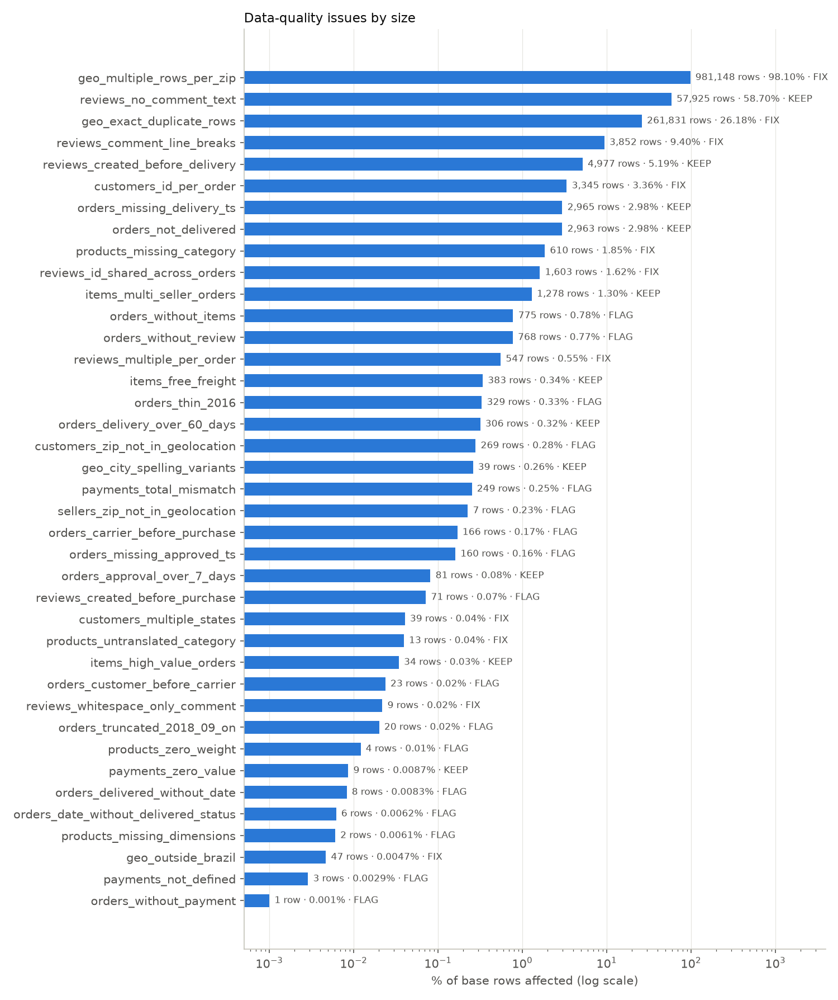
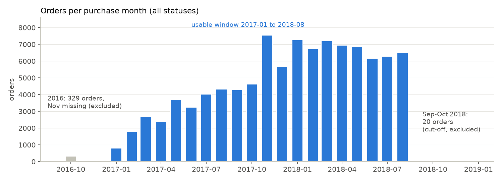

# Data-Quality Report

**Dataset:** Olist Brazilian e-commerce (Kaggle `olistbr/brazilian-ecommerce`), 9 tables · **Audit date:** 2026-10-19
**Produced by:** `notebooks/00_data_quality_audit.ipynb` → checks in `sql/03_data_quality_checks.sql` → full table in `sql/results/data_quality_audit.csv`.
Every number below comes from that run.

## 1. Summary

- **45 checks** across all 9 tables. Each records the issue's **size**, a **decision** and the **action taken**.
- **The data is usable after targeted fixes.** After the fixes in `sql/01_staging.sql`, **97,467 of 99,441 orders (98.01%) carry no data-quality flag**.
- **The headline late rate barely moves when flagged orders are excluded:** 6.77% across all 96,470 delivered orders vs **6.67%** across the 95,392 delivered orders with no flags. Keeping the flagged orders doesn't distort the main metric.
- **The issues that would have caused wrong answers if left alone** (all handled):
  1. `customer_id` is per order, not per person (3,345 extra ids) → wrong repeat-customer rate.
  2. Several review rows per order (547 orders) and non-unique `review_id` (1,603 rows) → double-counted reviews.
  3. ~1M geolocation rows for 19,015 zip prefixes, with 261,831 exact duplicates → joining directly would multiply rows.
  4. Thin 2016 data and a cut-off after 2018-08 → misleading trends and growth rates.
  5. Date-only delivery estimates → a timestamp comparison would wrongly mark 1,292 same-day deliveries as late (see `docs/PROGRESS.md`).

| Decision | Meaning | Checks |
|---|---|---|
| FIX | corrected in `sql/01_staging.sql` / star schema | 12 |
| FLAG | kept, labelled in `fact_orders.dq_flags` or excluded by a stated filter | 17 |
| KEEP | genuine business behaviour (or checked and clean), no change | 15 |
| SCOPE | deliberately out of scope | 1 |

## 2. Key issues explained

### 2.1 Identity: `customer_id` ≠ customer
There are 99,441 `customer_id`s but only 96,096 `customer_unique_id`s, because Olist issues a new `customer_id` for every order. **Fix:** `dim_customer` is one row per `customer_unique_id`. **Why:** counted per `customer_id`, everyone looks like a one-time buyer and the repeat rate is wrong. 39 people appear with addresses in more than one state; the address of their most recent order is kept.

### 2.2 Reviews: duplicates, shared ids, missing text
- 547 orders have more than one review row. **Fix:** keep the most recently answered review (tie-breakers: creation date, then review_id).
- `review_id` is not unique: 1,603 rows share a review_id with another order. **Fix:** reviews are keyed by `order_id`; `review_id` is never used as a key.
- 58.70% of reviews have no comment text after cleaning (only a star score). **Keep:** the score is still valid; the text classifier (Module 2) runs on the 40,748 reviews that do have text. 3,852 comments contained line breaks and 9 were whitespace only; both are cleaned in staging.
- **4,977 reviews (5.19%) were created before the order was delivered**, and 71 before the purchase. **Keep / flag:** customers can review a parcel that hasn't arrived, which is relevant to the "never arrived" complaint theme. It also confirms that review fields must never be used as purchase-time ML features.

### 2.3 Orders: status, missing dates, impossible sequences
Missing dates almost always match the order's status:

| Status | Orders | No approval | No carrier date | No delivery date |
|---|---:|---:|---:|---:|
| delivered | 96,478 | 14 | 2 | 8 |
| shipped | 1,107 | 0 | 0 | 1,107 |
| canceled | 625 | 141 | 550 | 619 |
| unavailable | 609 | 0 | 609 | 609 |
| invoiced | 314 | 0 | 314 | 314 |
| processing | 301 | 0 | 301 | 301 |
| created | 5 | 5 | 5 | 5 |
| approved | 2 | 0 | 2 | 2 |

So a missing delivery date is a real problem in only **8 orders** ("delivered" with no date) and **6 orders** (cancelled but with a delivery date). Both are flagged and treated as *not delivered*. "Delivered" means status = delivered **and** a delivery date exists, which gives 96,470 orders.

Impossible sequences: 166 carrier pickups before purchase and 23 deliveries before pickup are **flagged**, not deleted. Approval before purchase and delivery before purchase were checked and **none were found**; those checks stay in place for future data refreshes.

775 orders have no items (767 of them are cancelled or unavailable), 768 have no review and 1 has no payment. All are **kept** in `fact_orders` via LEFT JOIN and flagged, so nothing disappears silently.

### 2.4 Time coverage

2016 has only 329 orders (with none in November), and only 20 orders were placed from September 2018 on, almost all cancelled. **Decision:** trends and model evaluation use **2017-01 to 2018-08**.

### 2.5 Geolocation
1,000,163 rows cover 19,015 zip prefixes; 261,831 rows are exact duplicates; 47 points lie outside Brazil's bounding box. **Fix:** remove out-of-box points, then average to **one row per zip prefix** (19,010; 5 prefixes had only bad points). **Why:** joining customers or sellers to the raw table would multiply rows, and bad points would drag zip centres abroad. As a result, 269 customers and 7 sellers have no coordinates; distance features for them will be NULL, which LightGBM handles natively.

### 2.6 Products and payments
- 610 products have no category, and the same 610 also lack name length, description length and photo count. **Fix:** category `'unknown'`. The translation file is missing 2 categories (13 products), which were added by hand. Column-name typos (`…_lenght`) were renamed.
- 2 products have no dimensions and 4 have weight 0. **Flag:** left as NULL / treated as missing in ML; not imputed in SQL.
- 249 orders' payment totals differ from items + freight by more than R$1. **Flag:** revenue is defined from item prices, so it isn't affected.
- `payment_type = 'not_defined'` on 3 records. **Flag.** The instalment column is **out of scope** by design: the project analyses payment *method* only.

## 3. What this means for the next steps

| Next step | Rule taken from this audit |
|---|---|
| EDA (Day 2) | Use `is_delivered`; trends limited to 2017-01..2018-08; prefer medians for skewed times (306 deliveries took more than 60 days) |
| ML (Day 3) | Never use review fields, carrier/delivery dates or `approval_hours` as features; NULL coordinates and dimensions are left for LightGBM to handle |
| Module 2 | Classify only the 40,748 reviews with text; text is Portuguese → multilingual model |
| Dashboards | Revenue = delivered orders, item price excluding freight; the same definitions as `fact_orders` |

## 4. Full audit table

Generated from `sql/results/data_quality_audit.csv` (pct = affected / base × 100).

| # | Table | Issue | Affected | Base | % | Decision | Action |
|---:|---|---|---:|---:|---:|---|---|
| 1 | orders | Orders not in status 'delivered' (shipped, canceled, unavailable, invoiced, processing, created, approved) | 2,963 | 99,441 | 2.98 | **KEEP** | Kept in fact_orders; delivery metrics use is_delivered only, revenue = delivered orders only. |
| 2 | orders | Missing approval timestamp (141 canceled, 5 created, 14 delivered) | 160 | 99,441 | 0.16 | **FLAG** | Kept as NULL; approval_hours is NULL for these orders and excluded from approval-time averages. |
| 3 | orders | Missing customer delivery date (mostly shipped / canceled / unavailable orders) | 2,965 | 99,441 | 2.98 | **KEEP** | Expected for undelivered orders; is_late and delivery_days are NULL unless is_delivered. |
| 4 | orders | Status 'delivered' but no customer delivery date | 8 | 96,478 | 0.01 | **FLAG** | dq_flags 'delivered_without_date'; treated as not delivered (is_delivered = false), so excluded from is_late. |
| 5 | orders | Canceled orders that nevertheless have a customer delivery date | 6 | 96,476 | 0.01 | **FLAG** | dq_flags 'date_without_delivered_status'; status wins, so not counted as delivered. |
| 6 | orders | Carrier pickup timestamp earlier than purchase timestamp (impossible sequence) | 166 | 97,658 | 0.17 | **FLAG** | dq_flags 'carrier_before_purchase'; carrier date not used as an ML feature (post-purchase anyway). |
| 7 | orders | Delivered to customer before carrier pickup (impossible sequence) | 23 | 96,475 | 0.02 | **FLAG** | dq_flags 'customer_before_carrier'; kept for is_late (customer date is the target), excluded in sensitivity checks. |
| 8 | orders | Approval earlier than purchase (checked, impossible sequence) | 0 | 99,281 | 0 | **KEEP** | None found; check retained so a future data refresh would surface it. |
| 9 | orders | Customer delivery earlier than purchase (checked, impossible sequence) | 0 | 96,476 | 0 | **KEEP** | None found; check retained. |
| 10 | orders | Orders with no rows in order_items (767 of them canceled or unavailable) | 775 | 99,441 | 0.78 | **FLAG** | dq_flags 'no_items'; kept in fact_orders via LEFT JOIN; order_value is NULL. |
| 11 | orders | Orders with no payment record | 1 | 99,441 | 0 | **FLAG** | dq_flags 'no_payment'; payment_type_main is NULL and excluded from payment analysis. |
| 12 | orders | Orders with no review | 768 | 99,441 | 0.77 | **FLAG** | dq_flags 'no_review'; excluded from review-score analysis (no imputation). |
| 13 | orders | 2016 has very few orders (Sep 4, Oct 324, Nov 0, Dec 1): platform ramp-up / incomplete extract | 329 | 99,441 | 0.33 | **FLAG** | Time trends start 2017-01; time-based ML split uses 2017+ for training. |
| 14 | orders | Orders purchased from 2018-09 onward (only 20, almost all canceled): extract cut-off | 20 | 99,441 | 0.02 | **FLAG** | Monthly trends end 2018-08; these months are not used for trends or model testing. |
| 15 | orders | Delivered orders taking more than 60 days (max about 210 days): extreme but plausible | 306 | 96,470 | 0.32 | **KEEP** | Kept (real customer experience); use medians / robust stats in EDA. |
| 16 | orders | Approval taking more than 7 days after purchase | 81 | 99,281 | 0.08 | **KEEP** | Kept; medians used for approval time; approval_hours is EDA-only (not an ML feature). |
| 17 | order_items | Duplicate (order_id, order_item_id) keys (checked) | 0 | 112,650 | 0 | **KEEP** | None found. |
| 18 | order_items | Items with freight_value = 0 (free shipping) | 383 | 112,650 | 0.34 | **KEEP** | Genuine free-shipping offers; kept. No items have price <= 0. |
| 19 | order_items | Orders containing items from more than one seller | 1,278 | 98,666 | 1.3 | **KEEP** | n_sellers stored; ML uses the primary seller (highest item value); seller rankings count the order for each seller. |
| 20 | order_items | Orders with item value above R$3,000 (max R$13,440) | 34 | 98,666 | 0.03 | **KEEP** | Plausible high-ticket purchases; kept; medians reported alongside means. |
| 21 | customers | customer_id is created per order; the real person is customer_unique_id (extra ids = repeat orders) | 3,345 | 99,441 | 3.36 | **FIX** | dim_customer built at customer_unique_id grain; repeat/cohort analysis uses it. |
| 22 | customers | The same person (customer_unique_id) appears with addresses in more than one state | 39 | 96,096 | 0.04 | **FIX** | dim_customer keeps the address of the most recent order. |
| 23 | customers | Customer zip prefix has no coordinates (missing from source or only out-of-Brazil points) | 269 | 96,096 | 0.28 | **FLAG** | lat/lng NULL in dim_customer; distance features will be NULL (LightGBM handles missing values natively). |
| 24 | order_payments | payment_type = 'not_defined' (all with value 0) | 3 | 103,886 | 0 | **FLAG** | Kept as its own category; too few to analyse (3 orders); excluded from method comparisons if needed. |
| 25 | order_payments | Payment records with value 0 (6 voucher, 3 not_defined) | 9 | 103,886 | 0.01 | **KEEP** | Zero-value vouchers are plausible; kept. |
| 26 | order_payments | Order payment total differs from items + freight by more than R$1 | 249 | 98,665 | 0.25 | **FLAG** | dq_flags 'payment_total_mismatch'; revenue is defined from item prices, not payments, so unaffected. |
| 27 | order_payments | payment_installments column present in source | 103,886 | 103,886 | 100 | **SCOPE** | Not selected in stg_payments: the project analyses payment method only. |
| 28 | order_reviews | Orders with more than one review row | 547 | 98,673 | 0.55 | **FIX** | stg_reviews keeps the most recently answered review per order (deterministic tie-breakers). |
| 29 | order_reviews | review_id is not unique: the same review_id is attached to several orders (rows affected) | 1,603 | 99,224 | 1.62 | **FIX** | review_id is not used as a key; reviews are keyed by order_id. |
| 30 | order_reviews | Reviews with no comment text after cleaning (NULL, empty or whitespace only) | 57,925 | 98,673 | 58.7 | **KEEP** | Score still used; theme classification (Module 2) runs only on reviews with text. |
| 31 | order_reviews | Comment present but whitespace only | 9 | 40,977 | 0.02 | **FIX** | Trimmed and converted to NULL in stg_reviews. |
| 32 | order_reviews | Comments containing line breaks (break naive CSV/line parsing) | 3,852 | 40,977 | 9.4 | **FIX** | Line breaks replaced by spaces in stg_reviews. |
| 33 | order_reviews | Review creation date earlier than the purchase (impossible sequence) | 71 | 98,673 | 0.07 | **FLAG** | Kept (score still valid); excluded from any review-timing analysis. |
| 34 | order_reviews | Review created before the order was delivered (survey sent before arrival) | 4,977 | 95,830 | 5.19 | **KEEP** | Real behaviour: customers can review undelivered parcels; relevant to 'never_arrived' theme in Module 2. Reviews are never ML features. |
| 35 | order_reviews | Review text is in Portuguese (all reviews with text) | 40,748 | 40,748 | 100 | **KEEP** | Module 2 uses a multilingual model / LLM; no machine translation step. |
| 36 | products | Products with no category (also missing name/description length and photo count) | 610 | 32,951 | 1.85 | **FIX** | category set to 'unknown' in stg_products; kept in all analyses. |
| 37 | products | Products whose category is missing from the translation file (pc_gamer, portateis_cozinha...) | 13 | 32,951 | 0.04 | **FIX** | Two translations added explicitly in stg_products. |
| 38 | products | Products with missing weight/size | 2 | 32,951 | 0.01 | **FLAG** | Left NULL (LightGBM handles missing values); not imputed in SQL. |
| 39 | products | Products with weight_g = 0 (physically implausible) | 4 | 32,951 | 0.01 | **FLAG** | Kept; tiny count; treated as missing in ML feature engineering. |
| 40 | products | Source column names misspelled ('product_name_lenght', 'product_description_lenght') | 2 | 9 | 22.22 | **FIX** | Renamed to *_length in stg_products. |
| 41 | sellers | Seller zip prefix has no coordinates | 7 | 3,095 | 0.23 | **FLAG** | lat/lng NULL in dim_seller; distance features NULL for those sellers. |
| 42 | geolocation | Exact duplicate rows (same zip, lat, lng, city, state) | 261,831 | 1,000,163 | 26.18 | **FIX** | Collapsed by aggregating to one row per zip prefix in stg_geolocation. |
| 43 | geolocation | Many coordinate rows per zip prefix (joining directly would multiply rows) | 981,148 | 1,000,163 | 98.1 | **FIX** | One row per zip prefix (average lat/lng, most frequent city/state). |
| 44 | geolocation | Coordinates outside Brazil's bounding box (lat -34..5.3, lng -74..-34.8) | 47 | 1,000,163 | 0 | **FIX** | Excluded before averaging; 5 zip prefixes had only such points and get no coordinates. |
| 45 | customers | Same customer zip prefix with more than one city spelling | 39 | 14,994 | 0.26 | **KEEP** | City names are not used as join keys (state and zip are); left as is. |
